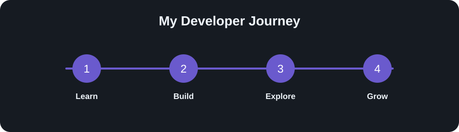

<!-- ==================== HERO SECTION ==================== -->

<h1 align="center">Hi, I'm Riddhi Khandelwal 👋</h1>

  <strong>Computer Science Student • Aspiring Software Developer</strong>

  

  

   Currently learning <strong>DSA, Full Stack Development & AI</strong>

---

<h3 align="center">✨ Explore My Developer Space</h3>

  <a href="#-project-vault">Projects</a> &nbsp;•&nbsp;
  <a href="#-my-developer-journey">Journey</a> &nbsp;•&nbsp;
  <a href="#-portfolio">Portfolio</a> &nbsp;•&nbsp;
  <a href="#-connect-with-me">Connect</a>

---

<!-- DASHBOARD_START -->

<!-- DASHBOARD_START -->

<!-- DASHBOARD_START -->

<h2 align="center"> Developer Dashboard</h2>

<table align="center">
  <tr>
    <th></th>
    <th>Current Status</th>
  </tr>
  <tr>
    <td> <strong>Status</strong></td>
    <td>Building, creating & growing 🚀</td>
  </tr>
  <tr>
    <td> <strong>Current Focus</strong></td>
    <td>Full Stack Development & DSA</td>
  </tr>
  <tr>
    <td> <strong>Exploring</strong></td>
    <td>Artificial Intelligence & Machine Learning</td>
  </tr>
  <tr>
    <td> <strong>Career Goal</strong></td>
    <td>Software Development Engineer</td>
  </tr>
</table>

<!-- DASHBOARD_END -->
##  My Developer Journey

  

<!-- DASHBOARD_END -->

> *I believe the best way to learn is by building, experimenting, and continuously improving.*
> 
<!--
**Riddhi-Khandelwal01/Riddhi-Khandelwal01** is a ✨ _special_ ✨ repository because its `README.md` (this file) appears on your GitHub profile.

Here are some ideas to get you started:

- 🔭 I’m currently working on ...
- 🌱 I’m currently learning ...
- 👯 I’m looking to collaborate on ...
- 🤔 I’m looking for help with ...
- 💬 Ask me about ...
- 📫 How to reach me: ...
- 😄 Pronouns: ...
- ⚡ Fun fact: ...
-->
